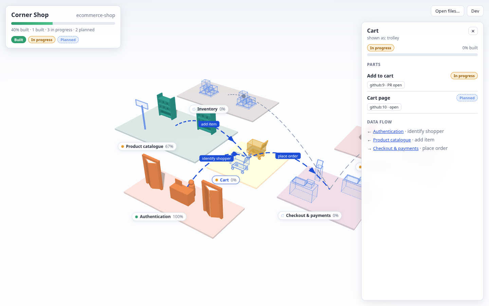

# Diorama

**See the software you're building as a living 3D miniature world.**

Diorama turns a software idea into a 3D model of the finished product, using a metaphor from the business's own world (an online shop becomes an actual shop). Every module starts as a translucent ghost and turns solid as the team closes the issues behind it. Managers, developers and clients can all see what's being built, how far along it is, and how the parts connect.

> 🚧 **Status: Phase 2, a static 3D viewer.** It isn't connected to GitHub yet. Follow along in [PHASES.md](PHASES.md).



## Try it

```sh
pnpm install
pnpm dev          # opens the corner-shop example
```

- Click a zone to see its parts, issues and data flows; hover a part to see its name.
- Press **Dev** to flip issue states (open → PR open → closed) and watch parts build.
- Load your own files with **Open files…**, by dropping them on the page, or with `?scene=<url>&issues=<url>`. See [examples/](examples/).

## How it works (planned)

1. Describe what you're building.
2. An AI agent asks a few questions and breaks it into modules.
3. Each module is mapped to a piece of a themed world: auth → entrance door, catalogue → shelves, cart → trolley, payments → checkout counter.
4. Connect your GitHub repo: issues and milestones drive the scene.
5. Close an issue and its piece of the diorama turns solid.

## Docs

- [plot.md](plot.md): the full picture, including vision, concepts, architecture and scene schema
- [PHASES.md](PHASES.md): the build plan, phase by phase
- [DECISIONS.md](DECISIONS.md): decisions made and still open

## License

[MIT](LICENSE)
